<div align="center">

<a href="https://differentiatorx.github.io/echo/"></a>

<br>

<a href="LICENSE"></a>


<a href="https://github.com/differentiatorX/echo/actions"></a>

<h3>
<a href="https://differentiatorx.github.io/echo/">Website</a> &nbsp;&nbsp;
<a href="#use-it-with-your-ai-agent">Use with AI agents</a> &nbsp;&nbsp;
<a href="#start-in-two-minutes">Install</a> &nbsp;&nbsp;
<a href="#how-it-ranks">How it ranks</a> &nbsp;&nbsp;
<a href="#credits">Credits</a>
</h3>

</div>


**Echo is a free, open-source AI clipper that turns long YouTube videos into the few Instagram Reels worth posting.** It does what OpusClip, Vizard, Submagic and Klap do, runs on your own machine, and is driven by the AI agent you already use: Claude Code, Antigravity, Cursor, Codex, Gemini CLI or Windsurf.

Your agent picks the moments. YouTube's own "Most replayed" data and timestamped comments confirm them. Echo cuts finished Reels with captions, sound effects and a cover. Then your agent reviews every clip, fixes the weak ones, and checks each against what Instagram says it rewards.

<p align="center"></p>

## Start in two minutes

**Windows.** Paste this into PowerShell:

```powershell
irm https://raw.githubusercontent.com/differentiatorX/echo/main/install.ps1 | iex
```

**macOS or Linux:**

```bash
curl -fsSL https://raw.githubusercontent.com/differentiatorX/echo/main/install.sh | bash
```

The installer:
- sets up Python, ffmpeg and Git if they're missing
- installs Echo
- connects it to every AI agent on your computer
- checks that everything works

Then pick one of these:

| You want | Do this |
|:--|:--|
| No agent, just answer questions | `echoclip start`, then paste a link and pick a style. Reels land in Videos/Echo. |
| Your AI agent does everything | Tell it: **"Use echo to make 4 Reels from https://youtube.com/watch?v=..."** |
| Claude Code shortcut | `/echo https://youtube.com/watch?v=... 4 beast` |
| A visual editor | `echoclip ui` |


## Use it with your AI agent


Echo is an **MCP server**, the plug-in standard that every major agent supports. One command connects it everywhere:

```bash
echoclip connect
```

| Agent | How Echo connects |
|:--|:--|
| Claude Code | registered with `claude mcp add`, plus the `/echo` skill |
| Claude Desktop | `claude_desktop_config.json` |
| Antigravity | `~/.gemini/config/mcp_config.json` |
| Cursor | `~/.cursor/mcp.json` |
| Codex | `~/.codex/config.toml` |
| Gemini CLI | `~/.gemini/settings.json` |
| Windsurf | `~/.codeium/windsurf/mcp_config.json` |
| VS Code agent mode | `echoclip connect vscode` prints the `.vscode/mcp.json` snippet |

Existing configs are merged and backed up, never replaced. Use `echoclip connect <agent> --print` to see the config without writing anything.

No MCP? This one line works in any agent that can run a terminal:

```
Run `echoclip guide` in the terminal and follow it exactly to make 4 Reels from https://youtube.com/watch?v=...
```

What your agent does:
1. **Prepares** the video. Captions, the replay curve and comments are read, and no video is downloaded yet.
2. **Judges** every moment.
3. **Cuts** the clips in the background.
4. **Reviews** each clip's exact words and frames.
5. **Fixes** weak openings, endings and hooks, re-rendering each fix in seconds.
6. **Exports** clips, covers and captions to one folder.

It never posts unless you ask.


## Built for how Instagram actually ranks

Instagram's head, Adam Mosseri, has named the signals that matter most for Reels: **watch time**, **sends per reach** (people DMing your Reel to a friend) and **likes per reach**. Sends weigh most for reaching people who don't follow you yet. Original content is favored. Echo is tuned for exactly that:

| Signal | What Echo does |
|:--|:--|
| Watch time | Cold-open teaser, silence and filler removal, punch-in zooms every few seconds, loop-friendly endings, an on-screen hook for sound-off viewers, and a progress bar |
| Sends | The judge scores the "would someone DM this to a friend" test. Captions end with a question or a send prompt. |
| Likes and saves | Keyword-rich first caption lines, since Instagram search reads captions, plus 3-5 specific hashtags |
| Originality | Your own edit of your own content. No reposts, no other-platform watermarks. |
| Reach testing | Trial reels go to non-followers first, and `echoclip besttime` finds when your followers are online |
| Readability | Captions and hook stay inside Instagram's safe zones, clear of the action buttons and the caption area |

Every clip gets an `instagram_check` that flags a late start, a missing hook, no send prompt, too many hashtags or a wrong length.


## How it ranks


| Signal | Where it comes from | Weight |
|:--|:--|:--:|
| **AI judgment** | Your agent, or Claude in the studio, scores hook, flow, value, shareability and loop | 60% |
| **Replay heat** | YouTube's Most replayed curve over the clip window | 25% |
| **Comment buzz** | Top comments quoting a timestamp, weighted by likes | 10% |
| **Pace** | Speaking energy compared with the rest of the video | 5% |
| **Your results** | Instagram views, shares and saves feed back into the judge every week | always on |


## Everything the paid clippers do, free

| Feature | Echo |
|:--|:--|
| AI clip picking with a virality score | yes, plus real replay and comment data |
| Prompt-based clipping ("only clips about money") | `--topic` |
| Clip length presets | short 15-30 s, medium 25-55 s, long 45-90 s |
| Auto reframe with face tracking | per-shot face crop, split screen for two speakers, blur fill for screen recordings |
| Aspect ratios | 9:16 Reels, 4:5 feed, 1:1 |
| Animated captions | 6 styles: Echo, Beast, Solo, Neon, Karaoke, Minimal, with keyword highlights |
| Hook titles, captions and hashtags | written for every clip |
| Silence and filler removal | yes |
| Auto zooms | punch-ins on cuts and every few seconds |
| Sound effects | whoosh on the teaser cut, pops on keywords, generated so there's no licensing |
| Background music with auto-ducking | your own tracks, lowered whenever someone speaks |
| Brand kit | logo, watermark and caption style |
| Cover images | grid-safe cover with the hook in big type |
| Text-based editing | click words to cut them, in the studio or through your agent |
| Multi-language | `--lang auto` or any Whisper language |
| Instagram posting, queue, trial reels and stats | official Graph API |
| Best time to post | from your follower activity |
| Export everything to one folder | `echoclip export` |
| API for agents | MCP server and JSON commands |
| Price | free, on your own machine |


## Time and tokens

Echo sends your AI the transcript, never the video, so tokens grow with how long people talk, not with file size. These are typical figures for 4 Reels from a talking video. The website has a live calculator.

| Video length | AI agent + review (GPU) | Studio, quick (GPU) | Without a GPU |
|:--|:--|:--|:--|
| 30 min | 5-11 min, about 42-66k tokens | 4-8 min, about 14-23k tokens | add 6-10 min |
| 1 hour | 6-11 min, about 48-75k tokens | 5-8 min, about 20-32k tokens | add 6-10 min |
| 2 hours | 7-12 min, about 60-94k tokens | 6-9 min, about 32-51k tokens | add 6-10 min |

Where the tokens go in agent mode:

| Step | Tokens |
|:--|:--|
| Judging brief: transcript, replay and comment tags, rules | about 250 per minute of video, plus 1k |
| Writing the picks | about 2.5k |
| Reviewing each clip: words, Instagram checks, 3 frames, one fix | about 5k per clip |
| Tool calls and replies | about 1k each |

Other things that affect the numbers:
- **First run:** on a new computer, Echo also downloads the speech model once, which takes a few minutes.
- **On a Claude plan:** tokens count toward your usage limits; they don't cost money per run.
- **Agent overhead:** agents re-read earlier steps as they work, so your app's meter can show more than the content Echo sends.
- **Saving tokens:** for the cheapest runs, use the studio's quick mode, or ask your agent to skip the frame review.

## Five minutes, start to finish


Echo never downloads or transcribes the whole video first. It reads YouTube's captions in seconds and your agent judges from those. Then it downloads only the chosen ranges in 1080p and runs Whisper on just those few minutes for exact word timing. Each clip renders in a single ffmpeg pass, using NVENC when an NVIDIA GPU is present.

## Commands

| Command | What it does |
|:--|:--|
| `echoclip start` | Beginner wizard: paste a link, pick a style, get Reels |
| `echoclip connect` | Plug Echo into every AI agent (MCP) |
| `echoclip ui` | Visual studio at 127.0.0.1:7777 |
| `echoclip doctor --fix` | Check setup and install anything missing |
| `echoclip prepare <url> --clips 4 --style echo --length medium --aspect 9:16 --topic "..."` | Read a video and write the judging brief |
| `echoclip finish <job> --detach` | Cut and render in the background |
| `echoclip status <job>` | Progress as JSON |
| `echoclip clips <job>` | Clips as JSON with words, captions, paths and Instagram checks |
| `echoclip frames <job> <clip>` | Opening, middle and ending frames |
| `echoclip fix <job> <clip> --start-at 12 --hook "..." --style solo` | Fix and re-render one clip |
| `echoclip cover <job> <clip>` | Grid-safe cover image |
| `echoclip export <job>` | Clips, covers and captions to Videos/Echo |
| `echoclip besttime` | When your followers are online |
| `echoclip publish <job> <clip> --trial` | Post to Instagram, only when you ask |
| `echoclip guide` | The agent playbook |

## Settings worth knowing

Open **Settings** in `echoclip ui`, or edit `~/.echo/settings.json`:

- **Watermark:** your @handle.
- **Logo:** a PNG, shown top-right inside the safe zone.
- **Background music:** a song or a folder of songs you have rights to.
- **Sound effects:** on or off.
- **Default caption style:** one of the six above.
- **Clip length:** default length range.
- **Instagram:** your connection details.

## Post to Instagram

1. Switch to a professional Instagram account and link it to a Facebook Page.
2. Create a Meta app at developers.facebook.com, add Instagram, and request `instagram_basic`, `instagram_content_publish` and `pages_read_engagement`.
3. Paste the long-lived token and your Instagram user ID into **Settings → Instagram**.
4. Optional: turn on **Trial reels**.

Schedule the queue with `echoclip post-next` in cron or Task Scheduler. Run `echoclip stats` weekly so the judge keeps learning.

## Use it on the right videos

Clip your own videos, podcasts that allow clipping, or paid clipping campaigns. Reposting other people's videos without permission earns copyright strikes, and Instagram ranks unoriginal reposts down.

## Under the hood

```
echoclip/
  api.py         one set of functions behind the CLI, the MCP server and the studio
  mcp_server.py  Echo as an MCP server for any agent
  connect.py     one-command agent hookup
  wizard.py      echoclip start
  ingest.py      yt-dlp: metadata, replay heatmap, comments, captions, section downloads
  signals.py     heat, crowd and pace scoring
  select.py      scout, judge, fuse, pick (prompts/ holds the prompts)
  pipeline.py    resumable jobs in ~/.echo/jobs
  edit.py        silences, fillers, cold open, punch zooms
  reframe.py     shots and faces into crop, split or blur layouts
  captions.py    6 animated caption styles inside Instagram safe zones
  render.py      one ffmpeg graph: reframe, captions, logo, SFX, ducked music, loudness, covers
  publish.py     Instagram publishing, queue, stats feedback
  server.py      local studio API (web/ holds the studio)
```

## Credits

<table>
<tr>
<td width="120" align="center" valign="top">
<a href="https://github.com/differentiatorX"></a>
</td>
<td valign="top">

### Madhur Mittal
Designed and built Echo, from the ranking engine to the studio and the brand.<br>
Mathematics and Computing at Delhi Technological University, class of 2029. Full-stack, real-time systems, embedded and IoT.

<a href="https://github.com/differentiatorX"></a>
<a href="https://linkedin.com/in/differentiatorx"></a>
<a href="https://www.instagram.com/madhurdrishti"></a>

</td>
</tr>
</table>

### Standing on the shoulders of

Echo is careful glue around remarkable open-source work. Thank you to every maintainer.

| Project | What it does here | License |
|:--|:--|:--|
| [Claude](https://www.anthropic.com/claude) and [Claude Code](https://docs.claude.com/en/docs/claude-code/overview) by Anthropic | Judges clips in the studio and through `/echo` | Anthropic terms |
| [yt-dlp](https://github.com/yt-dlp/yt-dlp) | Metadata, captions, replay heatmap, comments, section downloads | Unlicense |
| [FFmpeg](https://ffmpeg.org) and [libass](https://github.com/libass/libass) | Every cut, crop, caption and loudness pass | LGPL / ISC |
| [faster-whisper](https://github.com/SYSTRAN/faster-whisper), [CTranslate2](https://github.com/OpenNMT/CTranslate2), [Whisper](https://github.com/openai/whisper) | Word-level timestamps | MIT |
| [PySceneDetect](https://github.com/Breakthrough/PySceneDetect) | Shot boundaries | BSD-3 |
| [OpenCV](https://opencv.org) | Face detection for reframing | Apache-2.0 |
| [FastAPI](https://fastapi.tiangolo.com), [Uvicorn](https://www.uvicorn.org), [Pydantic](https://docs.pydantic.dev), [Typer](https://typer.tiangolo.com) | Studio backend, validation and CLI | MIT / BSD |
| [Anton](https://fonts.google.com/specimen/Anton), [Instrument Serif](https://fonts.google.com/specimen/Instrument+Serif), [Geist](https://fonts.google.com/specimen/Geist) | Caption, display and interface typefaces | SIL OFL 1.1 |

Built with Claude Code. Works with every agent that can run a terminal command.

## License

MIT, copyright 2026 Madhur Mittal. Bundled fonts keep their own SIL Open Font License, included next to each font file.

<div align="center">
<br>
<a href="https://differentiatorx.github.io/echo/"></a>
<br><sub>If Echo saves you an evening of editing, a star helps others find it.</sub>
</div>
