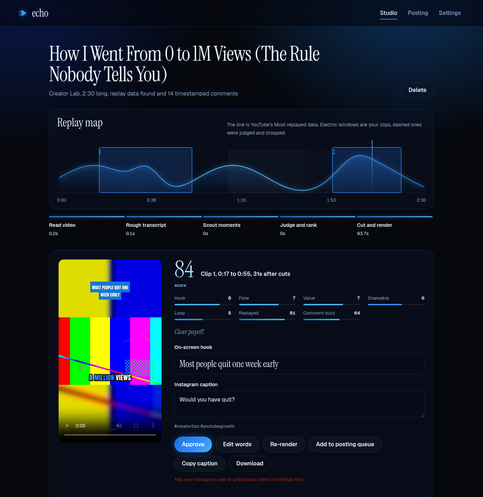

<div align="center">

<a href="https://differentiatorx.github.io/hookcut/"></a>

<br>

<a href="LICENSE"></a>


<a href="https://github.com/differentiatorX/hookcut/actions"></a>

<h3>
<a href="https://differentiatorx.github.io/hookcut/">Website</a> &nbsp;&nbsp;
<a href="#install">Install</a> &nbsp;&nbsp;
<a href="#how-it-ranks">How it ranks</a> &nbsp;&nbsp;
<a href="#the-edit">The edit</a> &nbsp;&nbsp;
<a href="#credits">Credits</a>
</h3>

</div>


**Hookcut is an open-source, local alternative to OpusClip, Vizard and Klap.** Paste a YouTube link and get the 3 to 5 Reels worth posting, not ten clips to sort through. Claude picks the moments. YouTube's own "Most replayed" data and timestamped top comments confirm them. Your Instagram results teach the judge what works on your account.

No credits. No uploads to someone else's cloud. It runs on your machine and judges clips through the Claude Code subscription you already have.

<p align="center"></p>


## How it ranks



| Signal | Where it comes from | Weight |
|:--|:--|:--:|
| **Claude's judgment** | A scout pass finds candidates. A harsh judge scores hook, flow, value, shareability and loop, tightens the boundaries, writes the on-screen hook and picks a cold-open line. | 60% |
| **Replay heat** | YouTube's Most replayed curve over the clip window. Real viewers rewound these seconds. | 25% |
| **Comment buzz** | Top comments that quote a timestamp ("12:34 had me dying"), weighted by likes. | 10% |
| **Pace** | Words per second compared with the rest of the video. Dead air loses. | 5% |
| **Your results** | Instagram views, shares, saves and watch time feed the judge prompt every week. | always on |

Missing signals drop out and the weights renormalize, so it still works on your own uploads and on videos with no replay curve. A final pass removes overlapping clips and near-duplicate ideas.


## Five minutes, start to finish



Hookcut never downloads or transcribes the whole video first. It reads YouTube's captions in seconds and has Claude judge from those. Then it downloads **only** the chosen ranges in 1080p and runs Whisper on just those few minutes for exact word timing. Each clip renders in a single ffmpeg pass, using NVENC when an NVIDIA GPU is present.

A one-hour podcast becomes 3 to 5 finished Reels in about 4 to 6 minutes, unattended.


## The edit

<table>
<tr>
<td width="50%" valign="top">

**Cold open**<br>The judge's most gripping line plays first as a teaser, then a hard cut back to the start.

**Jump cuts**<br>Silences over 0.35 s shrink to a breath and isolated um and uh disappear.

**Punch-in zooms**<br>Framing changes at every cut and at least every 3 seconds.

</td>
<td width="50%" valign="top">

**Speaker reframing**<br>Face-centered 9:16 crop per shot, an automatic split screen for two-person podcasts, a blurred backdrop for screen recordings.

**Captions people read**<br>Huge word-by-word captions with electric-blue active words and gold keywords, plus four presets.

**Finish**<br>An on-screen hook, a progress bar, your watermark, and loudness at -14 LUFS.

</td>
</tr>
</table>

Then edit by words. Click any word in the studio to cut it, rewrite the hook, switch caption style, and re-render one clip in seconds.


## Install

You need Python 3.10+, a full **ffmpeg** build, and **Claude Code** logged in once.

```bash
# ffmpeg
winget install Gyan.FFmpeg        # Windows
brew install ffmpeg               # macOS
sudo apt install ffmpeg           # Linux

# Claude Code, then run `claude` once to sign in
npm install -g @anthropic-ai/claude-code

# Hookcut
git clone https://github.com/differentiatorX/hookcut
cd hookcut && pip install -e .
hookcut doctor
hookcut ui                        # opens http://127.0.0.1:7777
```

No Claude Code? Set `ANTHROPIC_API_KEY` and switch the clip judge to API in Settings.

## Use it

**In the studio**, paste a link, choose 3 to 5 clips and a caption style, and press *Find clips*. Every clip shows its score breakdown and lets you edit the hook and caption, cut words, toggle the cold open, re-render, approve, download, or queue it for posting.

**From the terminal:**

```bash
hookcut run "https://youtube.com/watch?v=..." --clips 4 --style beast
hookcut rerender <job-id> c02
```

## Use it inside Claude Code

Hookcut ships a Claude Code skill. Install it once:

```bash
hookcut install-skill
```

Then, in Claude Code from any folder:

```
/hookcut https://youtube.com/watch?v=... 4 beast
```

Or just say "make reels from this" and paste a link. Claude Code runs the pipeline, then reviews every clip like an editor. It reads the opening words and checks frames for framing and caption placement. Clips with a slow start, a rambling ending or a vague hook get fixed and re-rendered. You get a post-or-skip verdict per clip with captions ready to paste. It never posts unless you ask.

After pulling a newer Hookcut, refresh the skill with `hookcut install-skill --force`.

## Post to Instagram

Hookcut posts through Instagram's official Graph API, with no browser automation.

1. Switch your Instagram account to a professional account and link it to a Facebook Page.
2. Create a Meta app at developers.facebook.com, add the Instagram product, and request `instagram_basic`, `instagram_content_publish` and `pages_read_engagement`.
3. Paste your long-lived access token and Instagram user ID into **Settings, Instagram**. Keep Facebook Login selected so videos upload straight from your computer.
4. Optionally turn on **trial reels**. Clips reach non-followers first and are shared with followers only if they perform.

Then schedule the queue. One or two Reels a day at fixed times works best:

```bash
0 13,20 * * * hookcut post-next      # crontab on macOS or Linux
0 9 * * 1     hookcut stats          # weekly, so the judge keeps learning
```

On Windows, add the same commands in Task Scheduler.

## Under the hood

```
hookcut/
  ingest.py      yt-dlp: metadata, replay heatmap, comments, captions, section downloads
  signals.py     heat, crowd and pace scoring
  select.py      scout, judge, fuse, pick        prompts/ holds the prompts
  llm.py         Claude Code CLI or Anthropic API, JSON out
  transcribe.py  faster-whisper word timestamps
  edit.py        cut list: silences, fillers, cold open, punch zooms
  reframe.py     shots and faces into crop, split or blur layouts
  captions.py    animated ASS captions
  render.py      one ffmpeg filtergraph per clip
  pipeline.py    resumable jobs in ~/.hookcut/jobs
  publish.py     Instagram publishing, queue, stats feedback
  server.py      local studio API
  web/           the studio, no build step
```

Every stage is idempotent. A failed run resumes where it stopped, and edits re-render one clip without touching the rest.

## Use it on the right videos

Clip your own long-form videos, podcasts that allow clipping, or creators running paid clipping campaigns. Reposting other people's videos without permission earns copyright strikes, and Instagram ranks unoriginal reposts down anyway. Talking content clips best: podcasts, interviews, debates, storytime.

## Roadmap

- Animated emoji overlays
- AI b-roll
- YouTube Shorts and TikTok publishing
- Multi-account posting
- One-click Windows installer


## Credits

<table>
<tr>
<td width="120" align="center" valign="top">
<a href="https://github.com/differentiatorX"></a>
</td>
<td valign="top">

### Madhur Mittal
Designed and built Hookcut, from the ranking engine to the studio and the brand.<br>
Mathematics and Computing at Delhi Technological University, class of 2029. Full-stack, real-time systems, embedded and IoT.

<a href="https://github.com/differentiatorX"></a>
<a href="https://linkedin.com/in/differentiatorx"></a>
<a href="https://www.instagram.com/madhurdristi"></a>

</td>
</tr>
</table>

### Standing on the shoulders of

Hookcut is careful glue around remarkable open-source work. Thank you to every maintainer.

| Project | What it does here | License |
|:--|:--|:--|
| [Claude](https://www.anthropic.com/claude) and [Claude Code](https://docs.claude.com/en/docs/claude-code/overview) by Anthropic | Scouts and judges every clip | Anthropic terms |
| [yt-dlp](https://github.com/yt-dlp/yt-dlp) | Metadata, captions, replay heatmap, comments, section downloads | Unlicense |
| [FFmpeg](https://ffmpeg.org) and [libass](https://github.com/libass/libass) | Every cut, crop, caption and loudness pass | LGPL / ISC |
| [faster-whisper](https://github.com/SYSTRAN/faster-whisper), [CTranslate2](https://github.com/OpenNMT/CTranslate2), [Whisper](https://github.com/openai/whisper) | Word-level timestamps | MIT |
| [PySceneDetect](https://github.com/Breakthrough/PySceneDetect) | Shot boundaries | BSD-3 |
| [OpenCV](https://opencv.org) | Face detection for reframing | Apache-2.0 |
| [FastAPI](https://fastapi.tiangolo.com), [Uvicorn](https://www.uvicorn.org), [Pydantic](https://docs.pydantic.dev), [Typer](https://typer.tiangolo.com) | Studio backend, validation and CLI | MIT / BSD |
| [Anton](https://fonts.google.com/specimen/Anton), [Instrument Serif](https://fonts.google.com/specimen/Instrument+Serif), [Geist](https://fonts.google.com/specimen/Geist) | Caption, display and interface typefaces | SIL OFL 1.1 |

Built with Claude Code.

## License

MIT, copyright 2026 Madhur Mittal. Bundled fonts keep their own SIL Open Font License, included next to each font file.

<div align="center">
<br>
<a href="https://differentiatorx.github.io/hookcut/"></a>
<br><sub>If Hookcut saves you an evening of editing, a star helps others find it.</sub>
</div>
